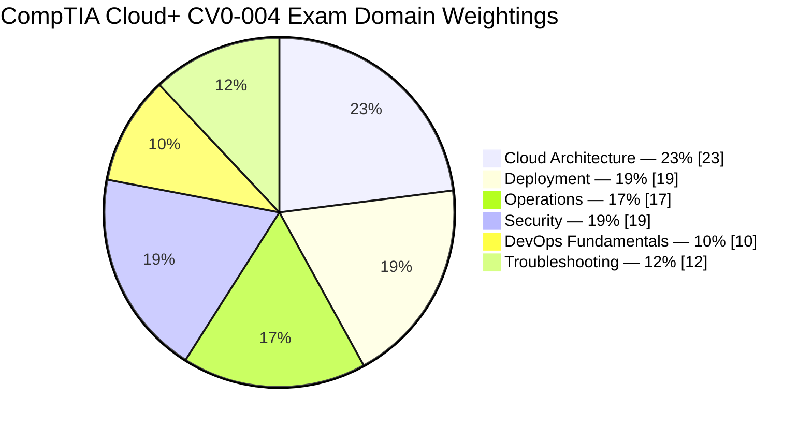
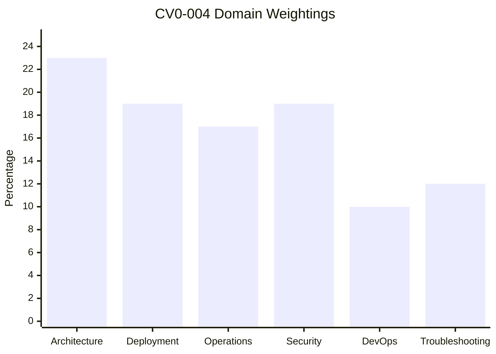
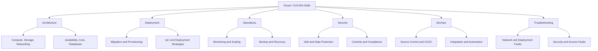
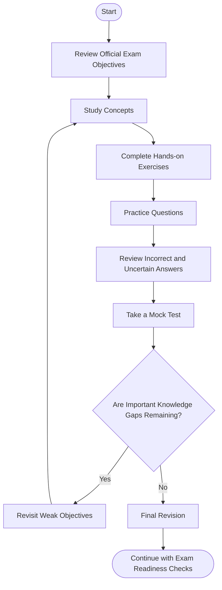
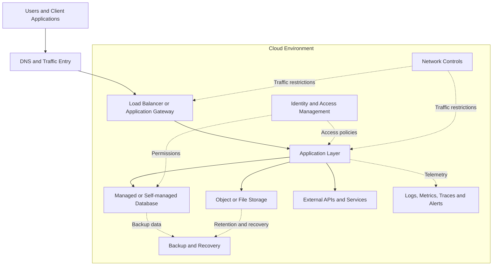
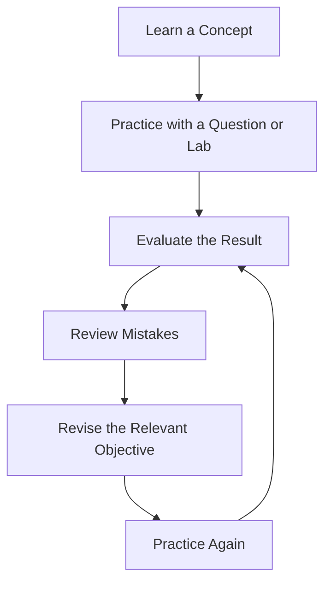
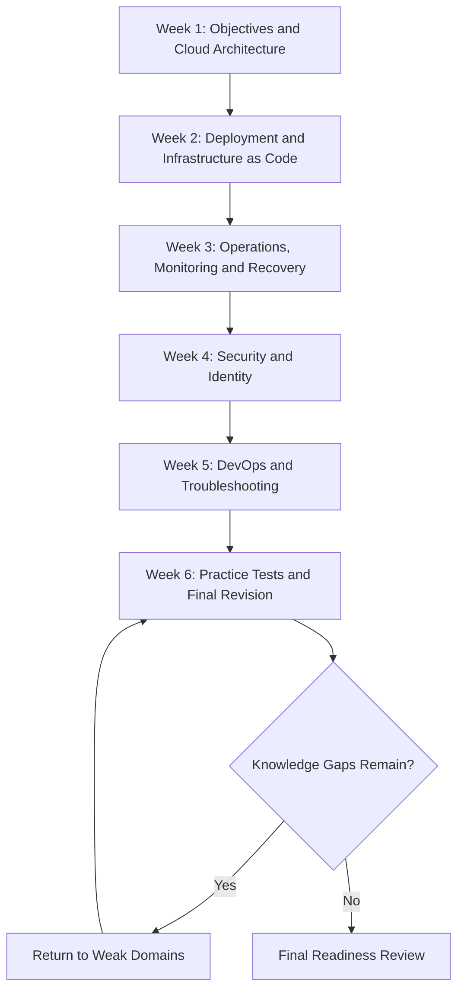

# CompTIA Cloud+ CV0-004 Study Guide

A practical, community-oriented study guide for the **CompTIA Cloud+ CV0-004 certification**. This repository organizes cloud concepts, exam objectives, technical diagrams, hands-on exercises, and practice strategies into a structured learning path.

Use this guide alongside the official CompTIA exam objectives and current cloud-platform documentation. For additional preparation, you can also explore the independent study resources available at [CertsGate](https://certsgate.com/).

## Table of Contents

- [About CompTIA Cloud+](#about-comptia-cloud)
- [Who Should Use This Guide?](#who-should-use-this-guide)
- [Exam Details](#exam-details)
- [Official Exam Objectives and Weightings](#official-exam-objectives-and-weightings)
- [Cloud+ Skills Map](#cloud-skills-map)
- [Preparation Flowchart](#preparation-flowchart)
- [Cloud Architecture Diagram](#cloud-architecture-diagram)
- [Study and Revision Cycle](#study-and-revision-cycle)
- [Step-by-Step Preparation Plan](#step-by-step-preparation-plan)
- [Suggested Study Schedule](#suggested-study-schedule)
- [Hands-On Labs and Projects](#hands-on-labs-and-projects)
- [Practice Questions and Mock Tests](#practice-questions-and-mock-tests)
- [Common Preparation Mistakes](#common-preparation-mistakes)
- [Certification Benefits and Career Relevance](#certification-benefits-and-career-relevance)
- [Frequently Asked Questions](#frequently-asked-questions)
- [Official and Additional Resources](#official-and-additional-resources)
- [About CertsGate](#about-certsgate)

## About CompTIA Cloud+

CompTIA Cloud+ is a vendor-neutral certification focused on the skills used to deploy, manage, secure, and troubleshoot cloud environments. The CV0-004 exam covers both cloud infrastructure concepts and operational practices, including automation, observability, identity and access management, disaster recovery, and fundamental DevOps workflows.

Unlike preparation focused on a single cloud provider, Cloud+ encourages you to understand the underlying principles and select appropriate solutions based on requirements such as performance, security, availability, compliance, and cost.

The certification is relevant to professionals working with cloud infrastructure, systems administration, cloud operations, and related technical responsibilities.

**Preparation resources:** Start with the [official CompTIA Cloud+ page](https://www.comptia.org/en-us/certifications/cloud), review the published objectives, and use practical exercises to reinforce what you learn.

## Who Should Use This Guide?

This repository may be useful for:

- Systems administrators expanding into cloud infrastructure.
- Cloud engineers reviewing architecture and operations concepts.
- IT professionals preparing for the CV0-004 exam.
- Network and server administrators learning cloud deployment and troubleshooting.
- DevOps practitioners strengthening their understanding of infrastructure and delivery workflows.
- Candidates who prefer visual diagrams, checklists, and practical learning tasks.

CompTIA lists **2–3 years of hands-on experience as a systems administrator or cloud engineer** as recommended experience. It also recommends CompTIA Network+ and Server+ or equivalent knowledge. These are recommendations, not a substitute for checking the current certification requirements.

## Exam Details

The following details are listed in CompTIA's published CV0-004 exam objectives. Confirm the current information with the official provider before booking.

| Detail | Information |
|---|---|
| Certification | CompTIA Cloud+ |
| Exam code | CV0-004 |
| Exam version | Cloud+ V4 |
| Maximum number of questions | 90 |
| Question types | Multiple-choice and performance-based |
| Exam duration | 90 minutes |
| Passing score | 750 on a scale of 100–900 |
| Recommended experience | 2–3 years in systems administration or cloud engineering |
| Recommended foundational knowledge | Network+ and Server+ or equivalent |

The passing score is a scaled score; it should not be interpreted as a simple percentage of questions answered correctly.

## Official Exam Objectives and Weightings

CompTIA's published CV0-004 objectives group the exam into six domains. Use the domain percentages to plan study time, but do not treat them as a guarantee of the number of questions you will receive in each area.

| Domain | Official exam weighting |
|---|---:|
| 1.0 Cloud Architecture | 23% |
| 2.0 Deployment | 19% |
| 3.0 Operations | 17% |
| 4.0 Security | 19% |
| 5.0 DevOps Fundamentals | 10% |
| 6.0 Troubleshooting | 12% |
| **Total** | **100%** |

### Official domain weightage chart

### Domain weightage comparison

The following bar chart uses the same published percentages for a second view of the domain distribution.

### What to study in each domain

#### 1. Cloud Architecture — 23%

Focus on choosing cloud service models, understanding availability and disaster recovery, designing cloud networks, comparing storage types, and evaluating workload performance and cost.

Important concepts include:

- IaaS, PaaS, SaaS, and FaaS.
- Regions, availability zones, RTO, and RPO.
- Virtual private clouds, subnets, routing, VPNs, and load balancing.
- Object, block, and file storage.
- Containers, virtualization, and cloud-native design.
- Database deployment options and workload optimization.
- Resource metering, tagging, and rightsizing.
- Cloud-related AI, machine learning, and IoT concepts.

#### 2. Deployment — 19%

Study deployment models, migration planning, provisioning, and repeatable configuration.

Pay particular attention to:

- Public, private, hybrid, and community cloud models.
- Blue-green, canary, rolling, and in-place deployment.
- Cloud migration strategies and compatibility considerations.
- Infrastructure as Code (IaC) and Configuration as Code (CaC).
- Variables, conditionals, versioning, testing, and drift detection.
- Selecting compute, storage, network, and security resources from requirements.

#### 3. Operations — 17%

Learn how to maintain reliable cloud services after deployment.

Review:

- Logging, tracing, monitoring, metrics, and alerting.
- Horizontal versus vertical scaling.
- Triggered, scheduled, and manual scaling.
- Full, incremental, and differential backups.
- Retention, replication, recovery testing, and encryption.
- Resource lifecycle management, patching, and decommissioning.

#### 4. Security — 19%

Focus on applying controls to real requirements rather than memorizing isolated definitions.

Key areas include:

- Vulnerability scanning, assessment, and remediation.
- Compliance, data classification, sovereignty, and retention.
- Identity and access management (IAM).
- Federation, MFA, SAML, OpenID Connect, and authorization models.
- Zero Trust, least privilege, hardening, and secrets management.
- Encryption, firewalls, WAFs, network ACLs, IDS/IPS, and DDoS protection.
- Monitoring suspicious activity and recognizing common attacks.

#### 5. DevOps Fundamentals — 10%

Understand how code, automation, and delivery workflows fit into cloud operations.

Review:

- Git, branches, commits, merges, and pull requests.
- Continuous integration and continuous deployment (CI/CD).
- Build, test, security, artifact, and deployment stages.
- REST, SOAP, RPC, WebSockets, GraphQL, and event-driven architectures.
- The purpose of tools such as Docker, Kubernetes, Terraform, Ansible, Jenkins, GitHub Actions, Grafana, and the ELK stack.

#### 6. Troubleshooting — 12%

Practice diagnosing symptoms systematically and confirming the underlying cause.

Review common problems involving:

- Resource allocation, permissions, quotas, and service availability.
- DNS, DHCP, NTP, NAT, routing, VLANs, and IP addressing.
- Latency, bandwidth, throughput, and network misconfiguration.
- Authentication, authorization, credentials, deprecated protocols, and vulnerabilities.

For the full scope, use the [official CompTIA exam objectives](https://comptiacdn.azureedge.net/webcontent/docs/default-source/exam-objectives/comptia-cloud-cv0-004-exam-objectives-%282-0%29.pdf) and check the current certification page for any updated version.

## Cloud Skills Map

This conceptual map connects the main skills you should develop. It is an independent study overview, not an additional official CompTIA weighting chart.

## Preparation Flowchart

Use this workflow to keep preparation structured. The readiness decision is a checkpoint: if important gaps remain, return to the relevant objectives and study materials before attempting another mock test.

## Cloud Architecture Diagram

The diagram below illustrates a generic cloud application environment. It is a learning example, not an official CompTIA reference architecture or a prescription for a particular provider.

When reviewing an architecture scenario, ask yourself:

1. What are the availability and recovery requirements?
2. Which resources need to communicate with one another?
3. Where should access controls be enforced?
4. Which components store persistent data?
5. How will the environment be monitored and restored?
6. What trade-offs exist between cost, performance, security, and complexity?

## Study and Revision Cycle

Cloud+ preparation works best as an iterative process. Reading a concept once does not demonstrate that you can apply it in a scenario.

Keep a short record of each mistake:

- **Topic:** Which objective or technical concept was involved?
- **Reason:** Did you misunderstand the concept, miss a requirement, or overlook a constraint?
- **Correction:** What principle or troubleshooting step resolves the issue?
- **Retest:** Can you solve a different example without notes?

This method turns practice into targeted learning instead of repeated guessing.

## Step-by-Step Preparation Plan

### Step 1: Establish your starting point

Read the official objectives and mark each area as familiar, partially understood, or unfamiliar. This helps you identify which topics need foundational study and which need hands-on practice.

### Step 2: Build cloud fundamentals

Review service models, deployment models, virtual networks, compute, storage, databases, and shared responsibility. For every concept, explain when it is useful and what trade-offs it introduces.

### Step 3: Practice deployment and automation

Create a small cloud environment or use a suitable local lab. Practice defining resources, configuring access, validating changes, and documenting how to reproduce the deployment.

### Step 4: Study operations and security together

Explore monitoring, alerting, scaling, backups, identity, encryption, and network controls. Consider how an operational failure could become a security or availability problem.

### Step 5: Develop a troubleshooting method

Use a consistent process:

1. Define the expected behavior.
2. Collect logs, metrics, configuration details, and error messages.
3. Identify likely failure points.
4. Test one hypothesis at a time.
5. Apply the smallest appropriate correction.
6. Verify the result and document the cause.

### Step 6: Practice DevOps workflows

Understand how source control, automated testing, deployment pipelines, artifacts, and infrastructure automation support reliable cloud operations. You do not need to treat every tool as interchangeable; learn what problem each tool solves.

### Step 7: Test readiness

Use timed practice to identify weak areas and improve decision-making under time pressure. Revisit the official objectives whenever your results reveal gaps.

## Suggested Study Schedule

This is an **illustrative six-week plan**, not an official CompTIA schedule. Adjust it to your experience, available time, and diagnostic results.

| Week | Main focus | Suggested evidence of progress |
|---|---|---|
| 1 | Cloud architecture | Explain service models, networking, storage, availability, and cost trade-offs |
| 2 | Deployment | Complete a repeatable provisioning or migration exercise |
| 3 | Operations | Demonstrate monitoring, scaling, backup, and recovery concepts |
| 4 | Security | Explain IAM decisions and choose suitable controls for scenarios |
| 5 | DevOps and troubleshooting | Trace a simple delivery pipeline and diagnose sample failures |
| 6 | Practice and revision | Review mock-test errors and explain answers without relying on memorization |

## Hands-On Labs and Projects

Practical work helps connect terminology to actual system behavior. Use a free tier, training sandbox, local virtual machines, containers, or other authorized environments where suitable. Check service costs before creating resources and remove temporary infrastructure when finished.

### Lab 1: Design a resilient application

Create a diagram for a small web application. Include traffic entry, application components, data storage, access controls, monitoring, and a recovery approach.

**Deliverable:** An architecture diagram with a short explanation of availability, security, and cost decisions.

### Lab 2: Provision infrastructure reproducibly

Use a tool such as Terraform or another suitable infrastructure-as-code solution to define a small, non-production environment.

Practice:

- Reviewing configuration before deployment.
- Tracking changes in version control.
- Identifying configuration drift.
- Validating changes before applying them.
- Removing resources safely.

**Deliverable:** A configuration example and deployment notes. Never commit credentials, tokens, or private keys.

### Lab 3: Monitor and troubleshoot a service

Run a test application in an authorized lab. Generate a controlled failure, such as an incorrect configuration or unavailable dependency, and examine logs, metrics, and error messages.

**Deliverable:** A short incident report describing symptoms, evidence, root cause, correction, and verification.

### Lab 4: Review access and recovery controls

Create a hypothetical access matrix for users and services. Apply least-privilege reasoning and document how important data would be backed up and restored.

**Deliverable:** An access-control table and a recovery checklist.

### Lab 5: Map a basic CI/CD pipeline

Draw a pipeline containing source control, build, test, security checks, artifact storage, deployment, and validation.

**Deliverable:** A pipeline diagram identifying where failures should stop the release and how changes could be rolled back.

These projects are independent learning exercises, not official CompTIA labs or a representation of the exact performance-based questions used in the exam.

## Practice Questions and Mock Tests

Practice questions are most valuable when they test your reasoning and expose gaps in your understanding. Start with untimed questions while learning, then introduce timed sets after you understand the main concepts.

You can use independent preparation resources, including the relevant study materials and practice resources available at [CertsGate](https://certsgate.com/). Treat third-party material as supplementary to the official objectives and hands-on study.

### Original practice questions

The questions below are independently written learning examples. They are **not official CompTIA questions** and are not intended to reproduce the live exam.

**Question 1 — Cloud architecture**

An application must remain available if one availability zone becomes unavailable. Which design consideration most directly supports this requirement?

A. Store all application components in one zone  
B. Distribute suitable application components across multiple availability zones  
C. Disable monitoring to reduce overhead  
D. Place all backups on the same application instance

**Answer: B.** Distributing appropriate components across multiple availability zones can reduce dependence on a single zone. The actual design must also account for data replication, failover, and application behavior.

**Question 2 — Operations**

A team wants to recover a service after accidental data deletion. Which practice provides the most useful evidence that recovery will work?

A. Increasing the number of dashboards  
B. Renaming the production resources  
C. Performing and validating recovery tests  
D. Disabling backup retention

**Answer: C.** A backup is useful only if the required data can be recovered. Testing validates both the recovery process and the integrity of restored data.

**Question 3 — Security**

A cloud administrator needs to grant a service account only the permissions required for one task. Which principle should guide the decision?

A. Least privilege  
B. Unrestricted access  
C. Shared administrator credentials  
D. Permanent access for every service

**Answer: A.** Least privilege limits access to the permissions needed for the intended task and reduces unnecessary exposure.

**Question 4 — Deployment**

A team wants to manage cloud resource definitions in version control and deploy them consistently. Which approach best fits this goal?

A. Configure every resource manually without recording changes  
B. Use Infrastructure as Code with reviewed, version-controlled definitions  
C. Store credentials in a public repository  
D. Skip validation after each deployment

**Answer: B.** Infrastructure as Code makes configuration changes reviewable and repeatable. Safe workflows also require validation, access controls, and secret management.

**Question 5 — Troubleshooting**

An application cannot resolve a service by its hostname, although the destination is reachable by IP address. What should you investigate first?

A. Database backup retention  
B. DNS resolution and relevant name records  
C. Container image size only  
D. The color of the monitoring dashboard

**Answer: B.** Successful access by IP but not by hostname suggests a name-resolution problem. Confirm DNS configuration and test resolution before making unrelated changes.

### How to review your answers

For every question:

1. Explain why the correct answer fits the requirements.
2. Identify the assumption that makes each incorrect option unsuitable.
3. Link the question to an official exam objective.
4. Try a variation with a different constraint, such as lower cost, tighter access, or faster recovery.
5. Revisit the concept if you cannot explain the reasoning without notes.

### Using mock tests effectively

- Complete an initial diagnostic test to identify weak domains.
- Use focused question sets during learning.
- Introduce timed practice when you can explain the underlying concepts.
- Track incorrect answers and uncertain guesses.
- Repeat weak topics after reviewing the relevant material.
- Use the official objectives to check for gaps that practice tests may not cover.

A strong practice result is useful evidence, but no practice test can guarantee a passing score.

## Common Preparation Mistakes

### Memorizing definitions without understanding decisions

Cloud+ scenarios may require you to select a solution based on availability, performance, cost, or security. Learn why an approach is suitable, not just what it is called.

### Ignoring the official objectives

A course or practice bank may not cover every objective. Use the official outline as your master checklist and verify that your study materials match CV0-004.

### Neglecting hands-on work

Practical exercises help you understand dependencies, configuration errors, and operational trade-offs. Even small labs can reinforce concepts that are difficult to learn through reading alone.

### Treating all cloud services as interchangeable

Different services and architectures have different limits, responsibilities, and cost models. Understand the underlying concepts, then verify implementation details in the relevant provider's documentation.

### Skipping incorrect-answer analysis

Repeatedly taking tests without investigating mistakes can reinforce misconceptions. Record the reason for each error and retest the concept later.

### Overlooking DevOps and troubleshooting

Do not spend all your preparation time on architecture or security. Review all six domains, including automation, integrations, and fault diagnosis.

### Relying on unauthorized exam dumps

Avoid materials that claim to provide leaked or guaranteed live exam questions. Use authorized study materials, original practice exercises, and the official exam objectives.

## Certification Benefits and Career Relevance

Cloud+ preparation can help build a structured understanding of cloud infrastructure and its operational lifecycle. The covered skills are relevant to work involving:

- Cloud infrastructure implementation and maintenance.
- Systems and cloud operations.
- Monitoring, backup, and recovery planning.
- Cloud security and access management.
- Infrastructure automation and deployment workflows.
- Cloud troubleshooting and service reliability.

The certification's relevance to a particular role depends on the employer, job requirements, practical experience, and other skills. Earning a certification does not by itself guarantee a job, promotion, or salary increase.

## Frequently Asked Questions

### What is the CompTIA Cloud+ CV0-004 exam?

CV0-004 is the exam code for CompTIA Cloud+ V4. It covers cloud architecture, deployment, operations, security, DevOps fundamentals, and troubleshooting.

### How long is the CV0-004 exam?

The published exam objectives list a duration of 90 minutes and a maximum of 90 questions. Confirm current exam information with CompTIA before booking.

### What is the passing score for Cloud+ CV0-004?

The published objectives list a passing score of 750 on a scale of 100–900. This is a scaled score, not a direct percentage.

### Which domain should I study first?

Begin with the official objectives and assess your existing knowledge. Cloud Architecture has the largest published weighting at 23%, but your plan should also address weak areas across the remaining domains.

### Is hands-on practice necessary?

Hands-on practice is strongly useful for understanding provisioning, configuration, monitoring, security, recovery, and troubleshooting. It complements conceptual study and scenario-based questions.

### Are the practice questions in this repository official?

No. The sample questions in this README are original educational examples. They are not official CompTIA exam items and are not represented as actual, leaked, or guaranteed questions.

### Can CertsGate replace official CompTIA resources?

No. Use CertsGate as an independent supplementary resource if its relevant materials help your preparation. The official objectives and current provider documentation should remain the foundation of your study plan.

### How can I tell whether I am ready?

You should be able to explain the main objectives, select appropriate solutions for scenarios, complete relevant practical exercises, and analyze your mistakes. Use mock tests to identify gaps, not as a guarantee of exam success.

### Where can I find the official objectives?

Start at the [CompTIA Cloud+ certification page](https://www.comptia.org/en-us/certifications/cloud). Use the current objectives linked by CompTIA to verify the applicable version and scope.

## Official and Additional Learning Resources

Use first-party documentation whenever you need to confirm exam requirements or implementation details.

### Official CompTIA resources

- [CompTIA Cloud+ certification page](https://www.comptia.org/en-us/certifications/cloud) — certification information and current exam resources.
- [CV0-004 exam objectives PDF](https://comptiacdn.azureedge.net/webcontent/docs/default-source/exam-objectives/comptia-cloud-cv0-004-exam-objectives-%282-0%29.pdf) — published exam domains, objective topics, and exam details. Check the main certification page for any newer version.
- [CompTIA exam policies](https://www.comptia.org/en-us/resources/test-policies) — review current policies before the exam.
- [CompTIA training resources](https://www.comptia.org/en-us/training) — official training and learning options.

### Technical documentation

Choose documentation that matches the platform you use in your labs:

- [Amazon Web Services documentation](https://docs.aws.amazon.com/)
- [Microsoft Azure documentation](https://learn.microsoft.com/en-us/azure/)
- [Google Cloud documentation](https://cloud.google.com/docs)
- [Terraform documentation](https://developer.hashicorp.com/terraform/docs)
- [Kubernetes documentation](https://kubernetes.io/docs/)
- [Docker documentation](https://docs.docker.com/)
- [Git documentation](https://git-scm.com/doc)

These technical resources are useful for learning and lab work. They do not replace CompTIA's exam objectives.

## About CertsGate

[CertsGate](https://certsgate.com/) is an independent resource for IT certification preparation. Depending on the exam and materials available, learners can explore study guides, practice questions, mock tests, and supporting learning content.

For CompTIA Cloud+ CV0-004, these resources can supplement a structured study routine:

1. Review the official exam objectives.
2. Learn the relevant cloud concepts.
3. Reinforce the concepts through practical exercises.
4. Use practice questions to identify weak areas.
5. Review errors and revisit the corresponding objectives.
6. Assess readiness before scheduling the exam.
